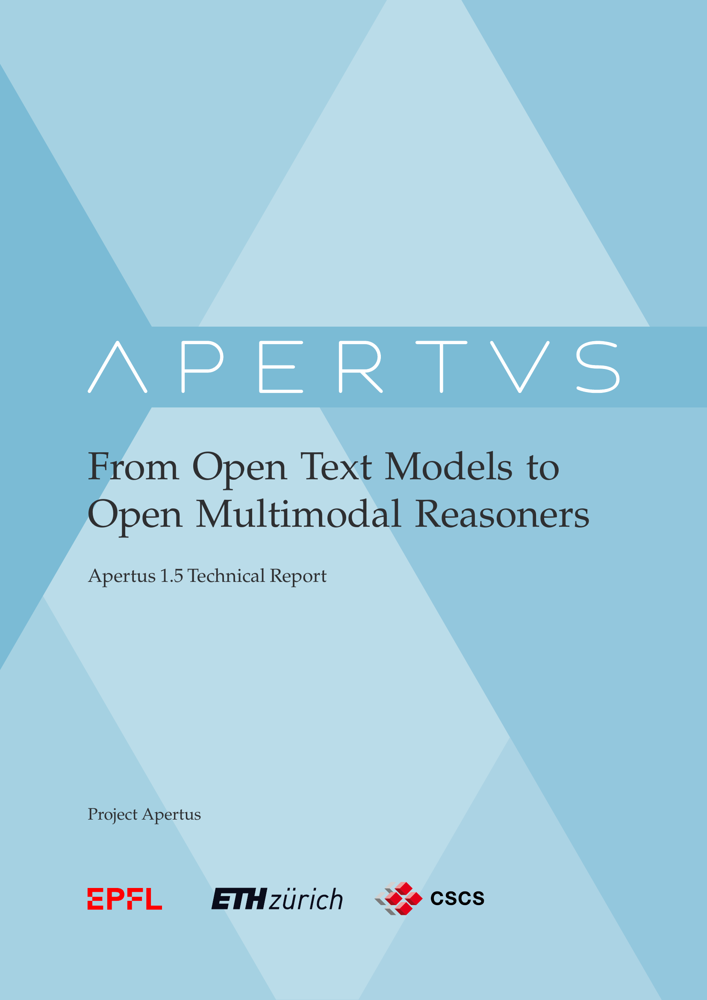

The technical report for [Apertus 1.5](https://huggingface.co/collections/swiss-ai/apertus-v15), _[Apertus 1.5: From Open Text Models to Open Multimodal Reasoners](https://arxiv.org/abs/2610.15542)_, is now on arXiv! It is the work of the whole Apertus team, and I am proud to have been the **coordinator** of writing this report.

Read the report on [arXiv](https://arxiv.org/abs/2610.15542) or [Hugging Face Papers](https://huggingface.co/papers/2610.15542), and try the models from the [Apertus 1.5 collection](https://huggingface.co/collections/swiss-ai/apertus-v15).
