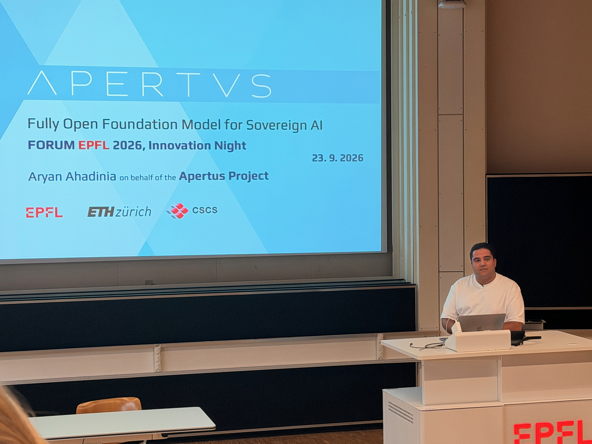

Presented [Apertus](https://www.swiss-ai.org/apertus), a fully open foundation model for sovereign AI, at the [Forum EPFL 2026](https://forum-epfl.ch/2026/en/) [Innovation Night](https://forum-epfl.ch/2026/en/your-area/start-ups/innovation-night/) on behalf of the Apertus project!

